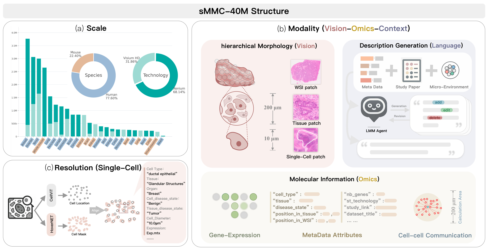

# sMMC-40M

**A context-aware resource and benchmark for cell-aligned spatial transcriptomics.**

[Data and release](docs/data.md) · [Benchmark](benchmark/README.md) · [Full results](results/README.md) · [QC](docs/quality_control.md) · [Release notes](CHANGELOG.md)



*Author-supplied resource overview. The frozen version described below is the numerical and implementation reference. See the [figure notes](docs/overview_figure.md) for differences between the illustration and this release.*

sMMC-40M connects spatial molecular measurements to histology, cell or nuclear
geometry, spatial coordinates, acquisition metadata, and source-backed biological
context. The **2026-10-28** frozen version has **38,472,192 gene-positive
cell/nucleus observations**, **124 acquisitions**, **23 harmonized reporting
categories**, and **7 source species**. The name “40M” denotes the resource scale;
it is not an exact count of whole cells.

| Platform | Acquisitions | Gene-positive observations |
| --- | ---: | ---: |
| Visium HD | 53 | 13,660,756 |
| Xenium | 71 | 24,811,436 |
| **Total** | **124** | **38,472,192** |

All **46,284,626 candidates** remain indexed, including candidates without an
expression-matrix row. The resource has raw integer expression in sample-level
H5AD, Parquet metadata, original measured feature axes, images/masks, coordinate
transforms, per-object image eligibility, and provenance. Acquisitions are not
assumed to be independent donors. The 23 labels include developmental, plant,
whole-organism, and xenograft categories; they are not 23 anatomical organs.

## What is available here

- The original overview image and a [124-acquisition catalog](data/sample_catalog.csv).
- Frozen release statistics, schema, source links, and compact QC tables.
- Runnable CONCH + Ridge code for HD and Xenium, spatial controls, exact fold/target
  plans, source-RNA preparation, CONCH encoding, and saved-prediction replay.
- Full numerical result tables, including the 23-category summary, HD confidence
  intervals and cross-acquisition validation, and historical Xenium results.
- Small reading examples and an offline synthetic benchmark demo.

**Data availability:** this is the public **code, documentation, and results**
repository. The approximately 932 GB complete local data version and the full
benchmark caches have been frozen and checked, but **have not been uploaded to a
public data host**. There is no announced Hugging Face dataset ID yet. Raw images,
counts, masks, embeddings, prediction arrays, and model weights are not stored in
Git. The complete data-side package is required for exact experimental replay.
[Availability and package requirements](docs/data.md#availability).

## Quick start

Python **3.10** is the reference runtime. Start with the pinned CPU environment:

```bash
git clone https://github.com/aicb-ZhangLabs/sMMC22M.git
cd sMMC22M
python -m venv .venv
source .venv/bin/activate
python -m pip install -r benchmark/requirements-cpu.txt

# These two commands do not require the large data package or a GPU.
python benchmark/smcc_benchmark.py list
python benchmark/smcc_benchmark.py demo --output /tmp/smmc-demo
python scripts/summarize_results.py
```

The demo uses generated data to check the spatial split, training-only target
selection, image-feature regression, controls, and metrics. Its scores are
**not biological benchmark results**. The reported biological results are under
[`results/`](results/README.md).

Once you have the complete frozen data package locally:

```bash
export SMMC_RELEASE_ROOT=/path/to/2026-10-28

# Recompute metrics from original saved predictions, without fitting a model.
python benchmark/smcc_benchmark.py replay --track hd18 --sample HD-001 \
  --output /tmp/smmc-replay

# Fit the predictor again on exactly the saved training rows and target genes.
python benchmark/smcc_benchmark.py refit --fold hd18_HD-001_seed0 \
  --output /tmp/smmc-refit

# Read real raw RNA and an H&E crop from the release.
python -m pip install -r benchmark/requirements-read.txt
python examples/read_release.py --release-root "$SMMC_RELEASE_ROOT" --sample HD-001
python benchmark/smcc_benchmark.py example --sample HD-001 \
  --output /tmp/smmc-example
```

The explicit `--benchmark-root /path/to/2026-10-28/benchmark` and
`--release-root /path/to/2026-10-28` options work as well. Outputs must be outside
the immutable release. [Complete reproduction instructions](benchmark/README.md).

## Benchmark snapshot

The modern coverage summary uses **18 HD categories / 48 acquisitions** and
**5 additional Xenium-only categories / 13 acquisitions**. It is a descriptive
category-weighted combination, not a controlled comparison between assays.

| Coverage | Acquisitions | Gene Pearson | Gene Spearman | Cell Pearson | F1 | R² | RMSE |
| --- | ---: | ---: | ---: | ---: | ---: | ---: | ---: |
| HD: 18 categories | 48 | 0.365 | 0.333 | 0.445 | 0.411 | −0.090 | 0.458 |
| Xenium-only: 5 categories | 13 | 0.303 | 0.263 | 0.419 | 0.289 | −0.152 | 0.399 |
| **Combined: 23 categories** | **61** | **0.351** | **0.318** | **0.439** | **0.385** | **−0.103** | **0.445** |

The combined coordinate-only and spatial-KNN Gene Pearson means are **0.049** and
**0.057**, respectively. HD whole-acquisition validation covers 34 held-out
acquisitions in 10 organ/species strata, with macro Gene Pearson **0.260**. The
separate matched-edge comparison is **0.354 within-acquisition → 0.248
cross-acquisition**; these scores use a different test denominator. Known related
material is disclosed, and guarded refits are available. No new-donor or combined
23-category confidence interval is claimed.

[All 23 categories and spatial controls](results/benchmark_23_categories.md) ·
[Full tables and interpretation](results/README.md) ·
[Protocols and uncertainty](docs/protocols.md)

## Version details

- HD uses VitaminP cell segmentation for H&E and nuclear segmentation for the IF
  branch, then aggregates **2 µm bins with strictly greater than 50% coverage of
  the full bin area**, with unique bin assignment. Native mask holes and separate
  components are retained.
- Xenium preserves native cellular expression and boundaries. DAPI image entries
  are still **cell** expression observations.
- HLDX010 uses the corrected matched non-diseased liver image and transform.
  Historical results from its wrong image pair are superseded and cannot be
  treated as valid current image evidence.
- HD annotation evidence is retained; cell-type predictions and sample disease
  context are not per-cell ground truth or malignancy labels.
- Pixel sizes vary across images. Native-pixel crop sizes and physical µm windows
  are different quantities.

The code repository keeps its established URL `sMMC22M`. Data-side files also
retain some historical `smcc`/`sMCC40M` identifiers for compatibility.
[Schema and release facts](data/release_summary.json) ·
[Attribution and usage](docs/attribution.md)

For questions, corrections, or reproducibility reports, please open an issue in
this repository with the release version, protocol track, and affected sample IDs.
