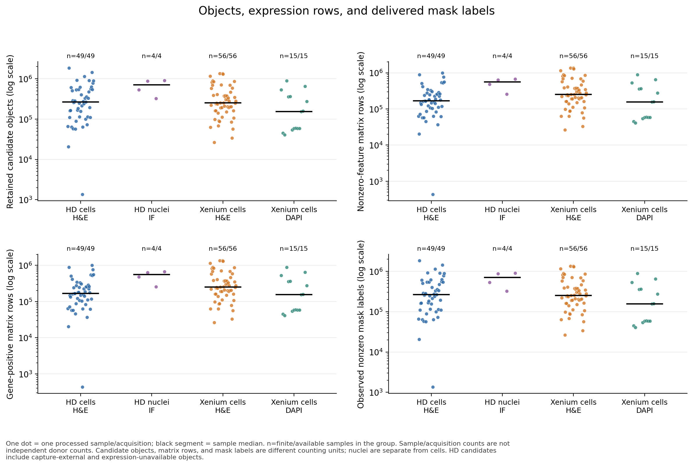

# Quality control and image eligibility

The frozen QC covers **53 HD and 71 Xenium acquisitions**, separating cell/nuclear
objects and H&E/IF/DAPI image branches. Start with the
[124-row compact table](../data/qc/sample_qc_compact.csv),
[branch summary](../data/qc/group_summary.csv), and
[measured-panel table](../data/qc/sample_gene_panels.csv).

## What the checks establish

- Candidate, matrix-nonzero, gene-positive, mask-present, and crop-complete
  denominators are kept distinct.
- Sparse matrix row links, integer counts, original feature axes, transforms,
  mask labels/geometry, and HD bin mappings have technical checks.
- Physical distances use **µm** and areas **µm²**. Pixel distances are not directly
  compared with native Xenium µm coordinates. Native areas already in µm² are
  not multiplied by pixel size again.
- HD bin allocation uses **strictly greater than half the full 2 µm bin area**;
  bins are unique. Mask holes and disconnected components are retained.
- Native Xenium cell and nuclear polygon summaries are checked separately. A
  nuclear reference linked to a native cell is not an additional independent
  nuclear observation.
- Gene Expression, negative-control probes/codewords, and protein features are
  distinguished. A panel without MT-prefixed genes has an unavailable
  mitochondrial statistic, not demonstrated absence of mitochondrial counts.

These are **technical consistency and availability** checks. Native polygon
summary agreement, centroid residuals, fragmented masks, and aspect ratios are
not independently labeled segmentation/registration accuracy, Dice/PQ, an
oversegmentation rate, or spindle-cell recall.

## Eligibility sidecars

The full release provides per-candidate flags for expression availability,
gene-positive RNA, centroid in selected image, delivered mask, native 150/224/256
px crop boundaries, and 50/100 µm physical windows. Cell and nucleus branches
are explicit. No observations are deleted by failing a flag. An image-edge
check does not guarantee useful tissue content or biological segmentation.

For generic H&E cell learning, first require the H&E/cell branch, gene-positive
RNA, centroid in image, and available mask; then choose a crop-size rule suited
to the task. Historical benchmark cohorts keep their original declared crop
and padding rules. Do not silently apply new eligibility filters to old scores.

## HLDX010 image correction

The previous liver package paired non-diseased-liver RNA with a liver-cancer
H&E image/CSV from the same source page. The matched official image and supplied
transform replaced that pair; no new registration was fitted. Native RNA, IDs,
feature axes, and transcript assignments were preserved. Image coordinates and
display masks were rebuilt and independently checked.

For 239,197 expression rows, centroids outside the selected image fell from
54.3456% to 0.000836%; incomplete 224 px crops fell from 54.9434% to 0.001254%.
Remaining outside-image observations retain their RNA and flags. The corrected
sample is the default in the frozen release; old image embeddings/predictions
are superseded and cannot be relabeled as corrected results.

HLDX010 QC was rerun after repair. The other 123 acquisitions reused their
already audited QC after identity guards passed; a new all-124 full scan was
not performed during the final assembly. Full reports, native geometry results,
repair evidence, and validation scope are retained in the data-side `qc/` and
`provenance/` folders.
